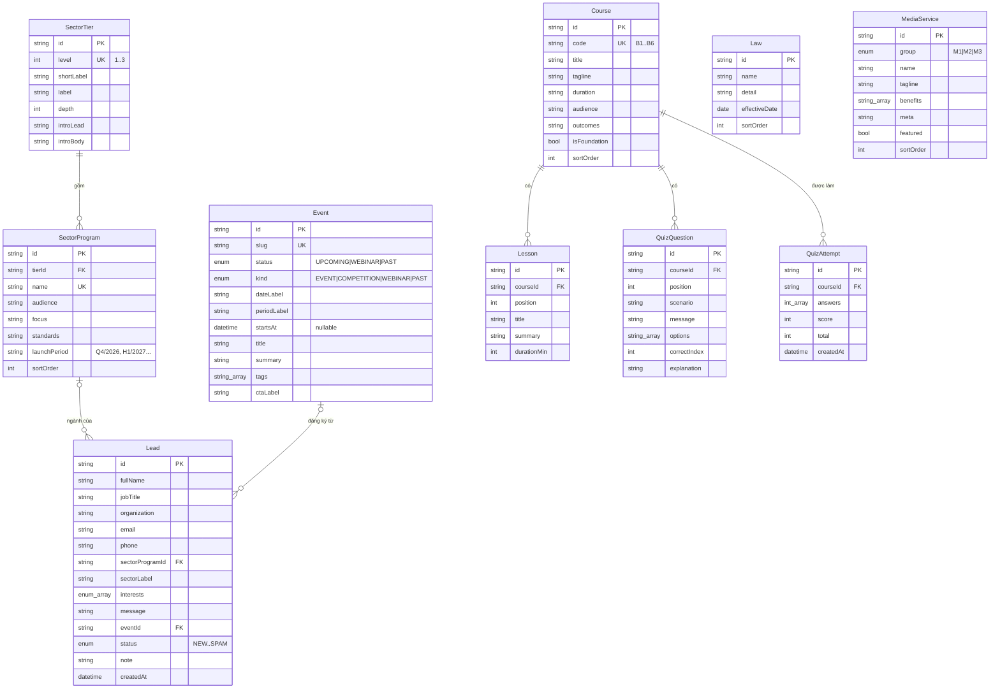

# Phân tích cơ sở dữ liệu – IARIS Cyber & Data

PostgreSQL + Prisma ORM. Schema: [`backend/prisma/schema.prisma`](../backend/prisma/schema.prisma) ·
Migration: [`backend/prisma/migrations`](../backend/prisma/migrations) · Seed: [`backend/prisma/seed.ts`](../backend/prisma/seed.ts)

## 1. Từ giao diện đến thực thể

Trang gốc chứa toàn bộ dữ liệu trong các mảng JavaScript. Mỗi mảng trở thành một bảng:

| Trên giao diện | Mảng trong bản gốc | Bảng | Ghi chú |
|---|---|---|---|
| Hero – "4 đạo luật · 12 tháng" | (HTML tĩnh) | `Law` | ngày hiệu lực lưu kiểu `DATE` |
| 6 khóa nền tảng B1–B6 | `F` | `Course` | `code` là khóa tự nhiên (unique) |
| Tabs Nhóm 1/2/3 + meter | `T` | `SectorTier` | `depth` = số vạch sáng trên meter |
| Bảng chương trình chuyên ngành | `T[].rows` | `SectorProgram` | cũng là danh sách "Ngành" trong form |
| 15 dịch vụ IARIS Media | `M` | `MediaService` | `group` enum M1/M2/M3, `featured` = thẻ xanh đậm |
| Sự kiện & Webinar | `E` | `Event` | `status` = tab lọc, `kind` = màu pill |
| Cổng học viên B6 (6 bài) | `L` | `Lesson` | thuộc `Course` B6 |
| Quiz "Bạn có nhận ra lừa đảo?" | `Q` | `QuizQuestion` | thuộc `Course` B6 |
| Kết quả quiz | (chỉ ở client) | `QuizAttempt` | **mới** – để thống kê |
| Form "Đăng ký và tư vấn" | (chưa gửi đi) | `Lead` | **mới** – lưu yêu cầu tư vấn |

Các con số ở dải thống kê (6 khóa, 16 ngành, 15 dịch vụ, 3 nhóm) **không lưu** mà được tính từ số dòng
của các bảng tương ứng, nên luôn khớp với dữ liệu.

Nội dung mang tính trình bày (sứ mệnh, 7 nguyên tắc biên tập, hình thức học…) giữ trong component React
vì hiếm khi đổi và không có quan hệ với dữ liệu khác.

## 2. Sơ đồ quan hệ (ERD)

## 3. Quyết định thiết kế

- **Khóa chính `cuid()`** thay vì số tự tăng: không lộ số lượng bản ghi qua API, an toàn khi seed lại.
- **Khóa tự nhiên unique** (`Course.code`, `SectorTier.level`, `SectorProgram.name`, `Event.slug`) cho phép
  seed theo kiểu *upsert* – cập nhật nội dung mà không làm gãy khóa ngoại của `Lead`/`QuizAttempt`.
- **`sortOrder`** trên mọi bảng nội dung để giữ đúng thứ tự hiển thị như bản gốc.
- **Mảng PostgreSQL** (`String[]`, `Int[]`, `Interest[]`) cho các danh sách ngắn, không cần truy vấn riêng
  (benefits, tags, options, answers, interests) – tránh thêm bảng nối không cần thiết.
- **Enum** cho các tập giá trị cố định (`MediaGroup`, `EventStatus`, `EventKind`, `Interest`, `LeadStatus`).
  API chuyển enum sang mã ngắn (`up/web/past`, `ev/com/web/past`) mà frontend dùng làm class CSS.
- **`Lead.sectorLabel`** lưu *snapshot* tên ngành lúc gửi, bên cạnh khóa ngoại `sectorProgramId`
  (`ON DELETE SET NULL`): đổi/xóa ngành không làm mất thông tin của lead cũ; "Ngành khác" vẫn lưu được.
- **`Lead.eventId`**: khi khách bấm CTA ở mục Sự kiện, form được điền sẵn và lead được gắn với sự kiện →
  đo được sự kiện nào tạo ra nhiều yêu cầu tư vấn.
- **`Lead.status` + `note`**: pipeline xử lý cho đội sales (NEW → CONTACTED → QUALIFIED → WON/LOST, SPAM).
- **`QuizAttempt`**: server tự chấm lại điểm (không tin điểm từ client) và lưu để thống kê tỷ lệ nhận diện
  lừa đảo – số liệu dùng được cho truyền thông.
- **Chỉ mục**: `Lead(status, createdAt)` cho màn hình quản lý, `Lead(email)` để tra trùng,
  `QuizAttempt(courseId, createdAt)` cho thống kê theo thời gian, `(group|status|tierId, sortOrder)` cho các truy vấn hiển thị.
- **Dữ liệu cá nhân** (Luật BVDLCN): chỉ `Lead` chứa dữ liệu cá nhân; API công khai chỉ được *ghi*,
  việc *đọc* yêu cầu `ADMIN_TOKEN`. `QuizAttempt` không chứa thông tin định danh.

## 4. Mở rộng gợi ý

| Nhu cầu | Thay đổi |
|---|---|
| Trang chi tiết khóa học | thêm `Course.slug`, `Course.description` (markdown), bảng `CourseSession` (lịch khai giảng, địa điểm, học phí) |
| Đăng ký học thật | bảng `Enrollment(leadId/userId, sessionId, status)` |
| Cổng e-learning thật | bảng `User`, `LessonProgress(userId, lessonId, completedAt)` – thay cho state minh họa ở client |
| Bản tin Cyber Brief | bảng `Subscriber(email, confirmedAt, unsubscribedAt)` |
| CMS cho nội dung | dùng Prisma Studio (`npm run db:studio`) hoặc thêm trang admin gọi API |
