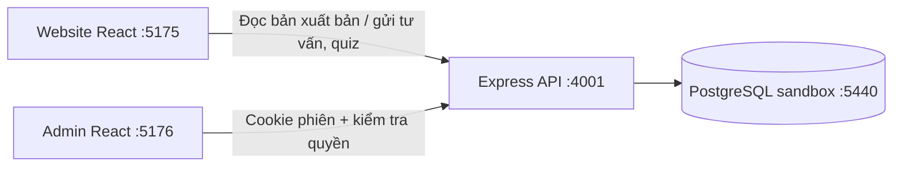

# Website và admin dùng chung database

Cập nhật 23/10/2026, áp dụng cho repo `MPGranji/iaris-web-sandbox`.

## Dữ liệu

Giữ 10 bảng nghiệp vụ đã có: `Law`, `Course`, `SectorTier`, `SectorProgram`, `MediaService`, `Event`,
`Lesson`, `QuizQuestion`, `QuizAttempt`, `Lead`.

Thêm 7 bảng:

| Bảng | Mục đích |
|---|---|
| `AdminUser` | Email, tên, mật khẩu băm scrypt, vai trò ADMIN/EDITOR/ADVISOR và trạng thái |
| `AdminSession` | Hash token phiên, người dùng, thời điểm hết hạn; thu hồi khi logout/đổi tài khoản |
| `SiteSection` | Nội dung Hero, giới thiệu, đối tác, Academy, Media, liên hệ và SEO theo các trường có sẵn |
| `ContentState` | Số phiên bản để phát hiện hai người cùng sửa; tránh ghi đè âm thầm |
| `Publication` | Snapshot nội dung công khai và bản xem trước, số phiên bản, người xuất bản |
| `AuditLog` | Ai lưu/xóa/sắp xếp/xuất bản, mục và ID liên quan; không ghi mật khẩu hoặc nội dung hồ sơ |
| `LeadEmail` | Thông báo chủ/xác nhận khách, nội dung thư, trạng thái gửi, lỗi và số lần thử |

`QuizAttempt.questions` giữ snapshot bộ câu hỏi khi chấm. Điểm cũ không bị tính lại theo đáp án sửa sau này.
Quiz công khai chấm theo bản đã xuất bản; thử quiz trong admin chấm theo bản nháp.

## Luồng dữ liệu

1. API admin chỉ đọc được sau khi đăng nhập. API kiểm tra vai trò trước khi ghi dữ liệu.
2. Sửa nội dung cập nhật các bảng nghiệp vụ và `ContentState` trong một transaction, đồng thời tạo audit log.
3. Nếu số phiên bản khác phiên đang sửa, API trả 409. Không ghi đè hoặc báo lưu thành công khi thất bại.
4. Xuất bản chụp dữ liệu thành `SiteContent` với danh sách trường cho phép. Loại tài khoản, hồ sơ tư vấn,
   ghi chú, phiên đăng nhập và audit log khỏi snapshot công khai.
5. Tất cả endpoint nội dung công khai đọc cùng snapshot mới nhất. Website cập nhật khi tải lại/quay lại tab,
   hoặc sau chu kỳ kiểm tra 30 giây khi tab đang hiển thị.
6. Form tư vấn ghi `Lead`; admin lấy 500 hồ sơ mới nhất, sửa trạng thái và ghi chú.
7. `LeadEmail` là outbox cho thông báo người phụ trách và xác nhận khách hàng, cùng transaction với lead.
   Có trạng thái preview/chờ/đang gửi/đã gửi/lỗi, nội dung thư và lịch sử thử gửi. Xem [CONSULTATION-EMAIL.md](CONSULTATION-EMAIL.md).

Cookie phiên HttpOnly, SameSite=Strict, hết hạn sau 8 giờ; Secure khi NODE_ENV=production.
API quản trị yêu cầu Origin nằm trong APP_ORIGINS cho các thao tác ghi và JSON Content-Type.
Không đưa token, mật khẩu hay hồ sơ vào localStorage. Đăng nhập sai có giới hạn theo IP trong tiến trình.

## Chạy và kiểm thử

Xem [SANDBOX.md](../SANDBOX.md). `.local/` và `backend/.env` chỉ tồn tại cục bộ, bị Git bỏ qua.
Migration mới: `backend/prisma/migrations/20261023000000_admin_integration/migration.sql`.
`sandbox:setup` tạo cluster PostgreSQL riêng, chạy migration và seed trên database trống.

Integration test tạo schema tên ngẫu nhiên `test_integration_*` trên cổng 5440/database `iaris_sandbox`,
kiểm tra đăng nhập, CSRF, bản nháp/xuất bản, lead, phân quyền, thu hồi phiên, quiz và lưu bền vững.
Chỉ schema kiểm thử đó bị xóa sau khi chạy. Không dùng database production cho bộ test.

`npm run test:frontend` render các component website trên server để xác nhận toàn bộ khối nội dung
đọc được cấu hình từ API/context và escape nội dung văn bản. Đây không phải kiểm thử thao tác trình duyệt.

Đây là nền tảng CMS sandbox. Chưa triển khai reset password/MFA, tài khoản học viên, thanh toán,
chứng nhận hoặc upload file. Trước khi triển khai nhiều instance cần thay limiter đăng nhập trong bộ nhớ
bằng limiter dùng chung và cấu hình origin/HTTPS/backup theo môi trường deploy thực tế.
